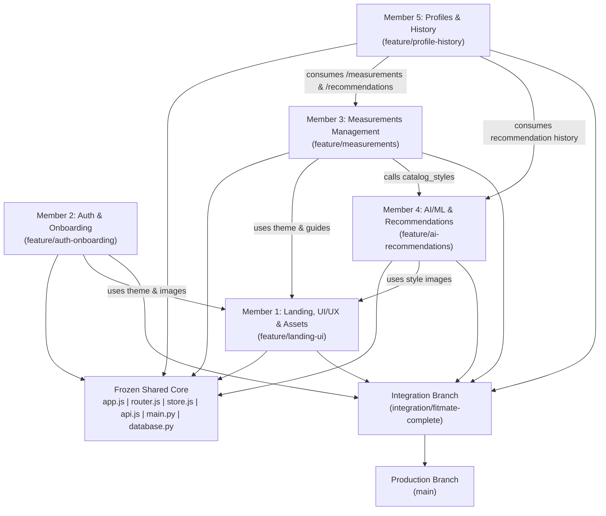

# FITMATE — STRICT FILE OWNERSHIP MATRIX

> [!IMPORTANT]
> **Zero-Overlap Rule**: Every mutable source file in `FIT/` belongs to **exactly ONE** team member. Shared core files are **FROZEN** during parallel development and may only be changed via an approved Integration Lead PR on `integration/fitmate-complete`.

---

## 1. Five-Member Architecture & Dependency Diagram

---

## 2. Exclusive File Ownership Table

| Owner | Branch | Assigned Files (Exclusive Write Access) |
| :--- | :--- | :--- |
| **Member 1** (UI/UX & Landing) | `feature/landing-ui` | `FIT/frontend/pages/LandingPage.js`, `FIT/frontend/components/TopNav.js`, `FIT/frontend/components/BottomTabBar.js`, `FIT/frontend/components/LoadingState.js`, `FIT/frontend/components/Toast.js`, `FIT/frontend/components/motion.js`, `FIT/frontend/styles/theme.css`, `FIT/frontend/config/images.js`, `FIT/frontend/assets/brand/*`, `FIT/frontend/assets/images/landing/*`, `FIT/frontend/assets/images/mens/*`, `FIT/frontend/assets/images/womens/*` |
| **Member 2** (Auth & Onboarding) | `feature/auth-onboarding` | `FIT/frontend/pages/AuthPage.js`, `FIT/frontend/pages/OnboardingPage.js`, `FIT/frontend/pages/DashboardPage.js`, `FIT/backend/app/routers/auth.py`, `FIT/backend/app/schemas/auth.py`, `FIT/backend/app/models/user.py`, `FIT/backend/app/tests/test_auth.py` |
| **Member 3** (Measurements) | `feature/measurements` | `FIT/frontend/pages/MeasurementsPage.js`, `FIT/frontend/assets/images/measurement-guides/*`, `FIT/backend/app/routers/measurements.py`, `FIT/backend/app/schemas/measurement.py`, `FIT/backend/app/services/unit_conversion.py`, `FIT/backend/app/tests/test_unit_conversion.py`, `FIT/backend/app/tests/test_validation.py` |
| **Member 4** (AI/ML & Recommendations) | `feature/ai-recommendations` | `FIT/frontend/pages/BrandProductPickerPage.js`, `FIT/frontend/pages/ResultPage.js`, `FIT/frontend/pages/ComparisonTablePage.js`, `FIT/backend/app/routers/comparison.py`, `FIT/backend/app/routers/recommendations.py`, `FIT/backend/app/routers/models.py`, `FIT/backend/app/routers/feedback.py`, `FIT/backend/app/schemas/recommendation.py`, `FIT/backend/app/schemas/feedback.py`, `FIT/backend/app/models/recommendation.py`, `FIT/backend/app/models/feedback.py`, `FIT/backend/app/services/catalog_styles.py`, `FIT/backend/app/services/ease_config.json`, `FIT/backend/app/services/ml_client.py`, `FIT/backend/app/services/model_service.py`, `FIT/backend/app/services/recommendation_engine.py`, `FIT/backend/app/services/recommendation_service.py`, `FIT/backend/app/services/feedback_service.py`, `FIT/backend/app/ml/*`, `FIT/backend/models/*`, `FIT/backend/src/*`, `FIT/backend/app/tests/test_all_five_models.py`, `FIT/backend/app/tests/test_ml_fallback.py`, `FIT/backend/app/tests/test_recommendation_strategies.py`, `FIT/backend/app/tests/test_feedback_and_extension.py` |
| **Member 5** (Profiles & History) | `feature/profile-history` | `FIT/frontend/pages/HistoryProfilesPage.js`, `FIT/backend/app/routers/users.py`, `FIT/backend/app/schemas/user.py` |

---

## 3. Frozen Shared Core & Companion Files (DO NOT MODIFY on Feature Branches)

| Category | Frozen Files | Change Protocol |
| :--- | :--- | :--- |
| **Frontend Core** | `FIT/frontend/index.html`, `FIT/frontend/app.js`, `FIT/frontend/routes/router.js`, `FIT/frontend/state/store.js`, `FIT/frontend/services/api.js`, `FIT/frontend/build.py`, `FIT/frontend/bundle.js` | Frozen interface. Any change requires Integration Lead approval and rebuild of `bundle.js` on `integration/fitmate-complete`. |
| **Backend Core** | `FIT/backend/app/main.py`, `FIT/backend/app/config.py`, `FIT/backend/app/database.py`, `FIT/backend/app/dependencies.py`, `FIT/backend/app/core/*`, `FIT/backend/app/schemas/common.py`, `FIT/backend/app/models/measurement.py`, `FIT/backend/seed.py`, `FIT/backend/alembic/*`, `FIT/backend/requirements.txt` | Frozen interface. `models/measurement.py` is shared read-only by Member 3 & Member 5. |
| **Companion / Admin** | `FIT/backend/app/routers/admin.py`, `FIT/backend/app/routers/brands.py`, `FIT/backend/app/routers/products.py`, `FIT/backend/app/routers/extension.py`, `FIT/backend/app/models/catalog.py`, `FIT/backend/app/schemas/catalog.py`, `FIT/backend/app/schemas/extension.py`, `FIT/backend/app/tests/conftest.py`, `FIT/backend/tests/test_fitmate.py` | Frozen baseline; run during integration verification. |
